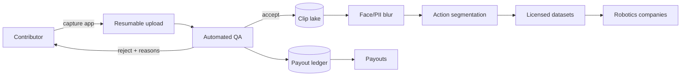

# Architecture — chore-footage

## 1. Scope
Two-sided marketplace collecting consented, high-quality egocentric chore video for robot training.
**MVP:** bounty catalogue, metadata-based clip QA (hard gates + quality score), quota tracking, payouts, buyer export manifest.
**Product:** capture app with on-device QA, upload pipeline, privacy redaction, labelling, dataset licensing.

## 2. System context

## 3. QA pipeline (order matters)
1. **Legal gates:** contributor consent signed, no unconsented bystander faces.
2. **Spec gates:** duration window, minimum resolution, fps, camera view.
3. **Integrity:** duplicate content hash, bounty quota remaining.
4. **Quality score:** `0.6·hands_visible + 0.4·lighting`, with a 50 minimum.
5. **Pay:** `min(minutes, quota_left) × rate × bonus`, where the bonus is 1.10 at quality ≥ 75 and 1.25 at ≥ 90.

The MVP collects *all* hard failures, not just the first, so a contributor fixes everything in one reshoot.

## 4. Design decisions
- **Metadata-driven QA.** The phone computes hands-visible ratio and lighting on-device, which
  saves bandwidth and gives instant feedback. The server re-verifies on a sample.
- **Quota clipping.** A clip that overfills a bounty is paid only for the remaining minutes, never rejected outright.
- **Consent as a hard gate**, recorded per clip and per bystander. The buyer manifest asserts consent.

## 5. Production architecture
Mobile app (on-device MediaPipe hand tracking), S3 multipart upload, a QA worker fleet (GPU for
face detection and blur), Postgres (contributors, bounties, clips, ledger), Stripe Connect payouts,
and dataset snapshots with manifests.

## 6. Privacy & compliance
Biometric laws (BIPA, GDPR Art. 9): faces are blurred before storage beyond the QA buffer, and
contributor face data is retained only with explicit consent. Children are excluded by policy.

## 7. Risks
Fraud (re-encoded duplicates) calls for perceptual hashing, not byte hashes, in the product.
Label quality calls for gold-standard tasks to grade labellers.
